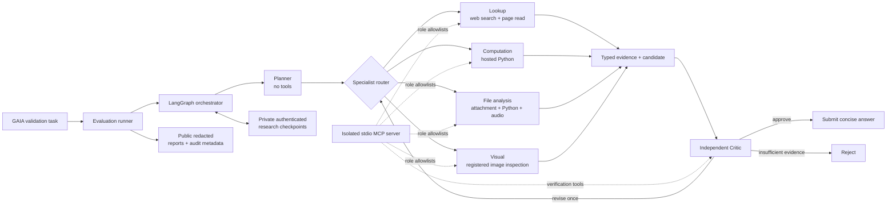

# toy_multi_agent

A reliability-first multi-agent system for solving and evaluating tool-assisted reasoning tasks on
the [GAIA benchmark](https://huggingface.co/datasets/gaia-benchmark/GAIA).

I built this project to explore a practical question: **how do you make a group of LLM agents
behave like a bounded, inspectable system instead of an open-ended chain of prompts?** The result is
a provider-neutral `Plan -> Act -> Verify -> Submit` workflow with role-specific tools, typed
intermediate state, recovery checkpoints, independent answer verification, and privacy-safe
evaluation artifacts.

The best completed 15-task run in this repository scored **46.67% (7/15)** on a deterministic,
balanced sample of the GAIA validation split. This is a project evaluation on 15 selected tasks,
not a claim about the full 165-question GAIA validation leaderboard.

## What I built

- A **LangGraph orchestration state machine** that controls planning, specialist execution,
  evidence repair, criticism, correction, rejection, and final submission.
- Six operational roles with explicit responsibilities: one Planner, four Specialists, and one
  Critic. A separate Evidence Linker reconnects restored private research to a candidate without
  inventing new evidence.
- A real **MCP v2 tool server** running as an isolated stdio subprocess. Every role receives only
  its allowlisted tools.
- Hosted web research, webpage reading, Python execution, attachment analysis, image inspection,
  and audio transcription without executing model-generated code on the host machine.
- Bounded reliability controls: global and per-stage deadlines, tool budgets, retries with backoff,
  loop detection, structured-response repair, search fallback/circuit breaking, and resumable
  authenticated checkpoints.
- A privacy-aware evaluation pipeline that excludes GAIA questions, reference answers,
  attachments, prompts, credentials, and hidden reasoning from public artifacts.
- Optional Langfuse tracing with operational summaries and usage data, while deliberately omitting
  sensitive task content and chain-of-thought.

## Architecture



The system is split into four planes:

| Plane | Responsibility | Main implementation |
| --- | --- | --- |
| Control | Own the graph, routing, budgets, correction loop, and terminal state | `orchestrator.py`, `runner.py` |
| Agent | Define role prompts, structured schemas, tool permissions, and local response repair | `agents.py`, `models.py` |
| Tool | Expose bounded MCP tools and keep execution outside the orchestrator process | `mcp_server.py`, `mcp_client.py`, `search.py` |
| Quality | Score answers, persist safe artifacts, recover state, report metrics, and trace operations | `scoring.py`, `persistence.py`, `research_notebook.py`, `reporting.py`, `observability.py` |

## How the implementation works

### 1. Plan

The Planner receives the task, level, attachment metadata, and available capabilities. It cannot
call tools or answer the task. It returns a typed `AgentPlan` containing one to eight ordered steps.
Invalid routing is normalized, and a conservative answer-free fallback route is available if both
the initial structured response and its local repair fail.

### 2. Act

Each plan step is dispatched to exactly one specialist:

| Specialist | Allowed tools | Evidence it may produce |
| --- | --- | --- |
| Lookup | `web_search`, `read_webpage` | Source evidence with URLs |
| Computation | `execute_python` | Reproducible computation evidence |
| File analysis | `read_attachment`, `execute_python`, `transcribe_audio` | File and computation evidence |
| Visual | `read_attachment` | Visual evidence from the registered attachment |

The orchestrator assigns trusted sequential evidence IDs, tracks which step produced every item,
rejects duplicate or malformed evidence, deduplicates repeated tool calls, and stops early when a
candidate has enough typed evidence for criticism.

### 3. Verify and correct

The Critic independently checks the candidate against the evidence and may use a bounded subset of
research tools. It returns `approve`, `revise`, or `insufficient_evidence` together with the exact
evidence IDs it checked. The graph permits at most one correction pass; an unsupported result is
rejected rather than silently submitted.

### 4. Submit and score

Only a concise GAIA-format answer with checked evidence can reach submission. The evaluation runner
then applies GAIA-compatible answer normalization and scoring, aggregates accuracy/latency/usage,
and writes deterministic JSON and Markdown reports.

### Reliability and recovery

Each vote has immutable Planner, Specialist, Critic, and global deadlines. Tool calls are counted
both globally and by stage. Recoverable provider failures use bounded retry/backoff; hosted search
can fall back to configured providers behind a circuit breaker. Structured stage output gets one
tool-free local repair instead of launching an unbounded second research path.

Local repair retains a bounded selection of successful research excerpts and safe source URLs.
Repair calls use low reasoning effort so the response budget can produce the structured result.
Specialist audit events and trace summaries record only allowlisted validation codes, initial/repair
outcomes, response status, and incomplete reasons such as `max_output_tokens`; research content
remains private.

After stable graph transitions, private research state is written to an authenticated sibling
checkpoint directory. `--resume` validates the persisted run configuration, restores only trusted
state, repairs incomplete public records, and skips already completed tasks.

### Security and privacy boundaries

- Secrets are accepted only from environment variables and are redacted from failures and traces.
- Attachments must be registered to the active task; path containment and file-type/resource limits
  are enforced.
- Public webpage reads reject non-public network destinations and apply redirect, timeout, and size
  limits.
- Python runs in hosted Code Interpreter, not on the local host.
- Public artifacts use strict schemas and allowlists. They do not contain task questions, reference
  answers, attachment contents/paths, prompts, model output, raw tool results, or hidden reasoning.
- Private research checkpoints are ignored by Git and are not part of benchmark reports.

## Best 15-task GAIA result

The best complete run used a deterministic sample with five tasks from each GAIA difficulty level.

| Metric | Result |
| --- | ---: |
| Overall accuracy | **46.67% (7/15)** |
| Level 1 | **100.00% (5/5)** |
| Level 2 | **40.00% (2/5)** |
| Level 3 | **0.00% (0/5)** |
| Critic approvals | 8/15 |
| Median task duration | 208.900 s |
| p95 task duration | 500.011 s |
| Total tokens | 959,469 |

Run configuration:

- model: `gpt-5.6-luna`
- reasoning effort: `max`
- sample size: `15`
- seed: `42`
- votes per task: `1`
- maximum steps: `8`
- maximum tool calls: `24`
- per-task timeout: `500` seconds
- dataset revision: `682dd723ee1e1697e00360edccf2366dc8418dd9`

The checked-in [aggregate report](benchmarks/gaia-15-best/report.md) and
[machine-readable summary](benchmarks/gaia-15-best/summary.json) contain the public, privacy-safe
result. The original completed run directory also passed the project's independent
`verify-results` integrity check before publication.

### How to interpret this result

This run is useful for comparing iterations of this project because the sample selection and
dataset revision are fixed. It is deliberately small and therefore has high statistical
uncertainty. It must not be compared directly with scores produced on the full GAIA validation set
or under different tool/model budgets.

The result also exposes the main remaining weakness: Level 3 tasks did not convert into correct
answers, and five tasks ended in malformed-response failures despite longer specialist budgets.
That points to structured-output robustness and hard-task synthesis as the highest-value next
improvements.

## Repository structure

```text
toy_multi_agent/
├── src/gaia_agent/
│   ├── agents.py              # Planner, specialists, Critic, Evidence Linker
│   ├── orchestrator.py        # LangGraph state machine and budget enforcement
│   ├── runner.py              # Dataset selection, voting, scoring, resume, composition
│   ├── mcp_server.py          # Isolated MCP tools and attachment/network policies
│   ├── mcp_client.py          # Role allowlists, tool accounting, safe tool envelopes
│   ├── providers/             # Provider-neutral interface and OpenAI/DeepSeek adapters
│   ├── persistence.py         # Public schemas, audit log, integrity and privacy checks
│   ├── research_notebook.py   # Private authenticated recovery checkpoints
│   ├── observability.py       # Privacy-safe optional Langfuse telemetry
│   ├── scoring.py             # GAIA-compatible answer normalization and scoring
│   ├── reporting.py           # Aggregate metrics and deterministic reports
│   └── cli.py                 # `evaluate` and `verify-results` commands
├── tests/                     # Unit, integration, E2E, privacy, and recovery tests
├── benchmarks/gaia-15-best/   # Published aggregate benchmark result
├── docs/superpowers/          # Design decisions and implementation plans
├── pyproject.toml
└── uv.lock
```

## Install

Requirements: Python 3.11 or newer and [uv](https://docs.astral.sh/uv/).

```console
uv sync --extra dev
```

Accept the gated GAIA dataset terms on Hugging Face, then provide credentials through the
environment:

```console
export OPENAI_API_KEY="YOUR_OPENAI_API_KEY"
export HF_TOKEN="YOUR_HUGGING_FACE_TOKEN"
```

Do not commit these values. `.env` is ignored and the CLI does not load it automatically.

## Run the evaluation

Start with a balanced three-task smoke run:

```console
GAIA_MAX_STEPS=1 uv run gaia-agent evaluate \
  --sample-size 3 \
  --seed 42 \
  --output-dir results/smoke-3

uv run gaia-agent verify-results results/smoke-3
```

Run the current `gpt-6.1-sol` / `low` configuration on the same deterministic 15-task sample:

```console
GAIA_MODEL=gpt-6.1-sol \
GAIA_REASONING_EFFORT=low \
GAIA_QUALITY_POLICY=benchmark \
GAIA_PROVIDER_MAX_ATTEMPTS=3 \
uv run gaia-agent evaluate \
  --sample-size 15 \
  --seed 42 \
  --votes 1 \
  --max-steps 8 \
  --max-tool-calls 24 \
  --timeout-seconds 500 \
  --planner-timeout-seconds 30 \
  --specialist-timeout-seconds 410 \
  --critic-timeout-seconds 60 \
  --specialist-max-tool-calls 18 \
  --critic-max-tool-calls 6 \
  --output-dir results/gaia-sol-low-seed42

uv run gaia-agent verify-results results/gaia-sol-low-seed42
```

The published 7/15 result remains a historical Luna/max run. The current Sol/low configuration
has not been benchmarked yet. Hosted search results and model outputs can change between runs.

Resume an interrupted run by repeating the same command and output directory with `--resume`.
Behavior-defining configuration must match the stored manifest.

## Key configuration

CLI options override `GAIA_*` environment variables, which override built-in defaults.

| Setting | Default | Purpose |
| --- | ---: | --- |
| `GAIA_MODEL` | `gpt-6.1-sol` | Production model |
| `GAIA_REASONING_EFFORT` | `low` | Reasoning level |
| `GAIA_SAMPLE_SIZE` | `15` | Balanced evaluation size; divisible by 3 |
| `GAIA_MAX_STEPS` | `8` | Maximum plan steps |
| `GAIA_MAX_TOOL_CALLS` | `24` | Global logical tool-call budget |
| `GAIA_TIMEOUT_SECONDS` | `300` | Global per-attempt deadline |
| `GAIA_VOTES` | `1` | Positive odd vote count |
| `GAIA_QUALITY_POLICY` | `benchmark` | Submission policy for degraded Critic repair |
| `GAIA_OUTPUT_DIR` | `results/gaia-15-seed42` | Public result directory |
| `GAIA_RESUME` | `false` | Restore a matching interrupted run |

Planner, Specialist, and Critic timeout/tool budgets, provider retry policy, search deadlines,
checkpoint sizes, context limits, fallback search providers, and optional Langfuse settings are
also configurable. See [.env.example](.env.example) and `uv run gaia-agent evaluate --help` for the
current interface.

## Test and verify

```console
uv run pytest
uv run ruff check .

# After running either evaluation command above:
uv run gaia-agent verify-results results/gaia-sol-low-seed42
```

The test suite covers agent schemas and permissions, graph transitions, MCP isolation, provider
adapters, dataset selection, scoring, persistence, checkpoint recovery, observability privacy,
report recomputation, and end-to-end reliability behavior.

## Design choices

The design and implementation history is retained under `docs/superpowers/`. Notable decisions
include the original multi-agent design, the LangGraph migration, observability/privacy boundaries,
trace-driven reliability improvements, and stage-level recovery.

## Limitations

- GAIA is gated; reproducing the evaluation requires accepting its dataset terms.
- Hosted tools and model calls can incur API charges.
- The published score covers only 15 deterministic validation tasks.
- The production composition is intentionally pinned to the configured Sol/low evaluation path;
  provider-neutral test adapters exist, but different production providers are not benchmark
  equivalent.
- Audio transcription uses `gpt-4o-mini-transcribe`; GPT-6.1 Sol does not support audio input.
- The project does not publish GAIA questions, reference answers, task-level predictions, or
  attachments.
